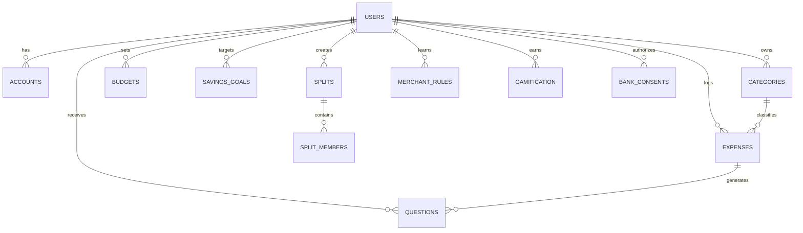

# Database Schema Diagram & Reference 🗄️

The database is powered by **SQLite** via a unified data model. Every ID is a client/server-generated UUID string and all timestamps follow ISO-8601 UTC.

---

## Tables Overview

### 1. `users`
Stores user profile, credentials, and onboarding preferences.
| Field | Type | Description |
|---|---|---|
| `id` | TEXT PK | UUID |
| `email` | TEXT UNIQUE | Email address |
| `password_hash` | TEXT | bcrypt hashed password |
| `name` | TEXT | Display name |
| `monthly_income` | REAL | Monthly pocket money / allowance |
| `income_source` | TEXT | 'parents', 'part_time_job', 'scholarship', etc. |
| `savings_goal` | REAL | Monthly savings target |
| `currency` | TEXT | Default 'INR' (₹) |
| `language` | TEXT | 'en', 'hi', 'pa', 'bn' |
| `pin_hash` | TEXT | Optional 4-digit PIN lock hash |
| `theme` | TEXT | 'system', 'light', 'dark' |
| `onboarding_done` | INTEGER | 0 or 1 |

### 2. `accounts`
Multi-account support (Cash, Bank, Wallets).
| Field | Type | Description |
|---|---|---|
| `id` | TEXT PK | UUID |
| `user_id` | TEXT FK | References `users(id)` |
| `name` | TEXT | 'Cash', 'SBI Savings', 'Paytm' |
| `type` | TEXT | 'cash', 'bank', 'wallet' |
| `balance` | REAL | Current balance |
| `is_default` | INTEGER | Default account flag |

### 3. `categories`
Default system categories and custom user categories with icons and colors.
| Field | Type | Description |
|---|---|---|
| `id` | TEXT PK | Category ID |
| `user_id` | TEXT FK | References `users(id)` |
| `name` | TEXT | 'Food', 'Travel', 'Shopping', etc. |
| `icon` | TEXT | Lucide icon identifier |
| `color` | TEXT | Hex color code |
| `is_custom` | INTEGER | 1 if created by user |
| `sort_order` | INTEGER | Display ordering |

### 4. `expenses`
The core table recording transactions.
| Field | Type | Description |
|---|---|---|
| `id` | TEXT PK | UUID |
| `user_id` | TEXT FK | References `users(id)` |
| `amount` | REAL | Positive amount (> 0) |
| `category_id` | TEXT FK | References `categories(id)` |
| `payment_method` | TEXT | 'upi', 'cash', 'card', 'wallet' |
| `date` | TEXT | ISO-8601 transaction date |
| `note` | TEXT | User remarks |
| `merchant` | TEXT | 'Swiggy', 'Uber', 'Dominos', etc. |
| `tag` | TEXT | 'need', 'want', 'savings' |
| `is_recurring` | INTEGER | 0 or 1 |
| `recurrence_rule`| TEXT | 'monthly', 'weekly' |
| `attachment_path`| TEXT | Relative file path in uploads/ |
| `bank_ref` | TEXT | Unique bank / UPI reference (prevents duplicates) |

### 5. `budgets`
Tracks overall or per-category spending limits.
| Field | Type | Description |
|---|---|---|
| `id` | TEXT PK | UUID |
| `user_id` | TEXT FK | References `users(id)` |
| `category_id` | TEXT FK | NULL for overall monthly budget |
| `amount` | REAL | Budget ceiling |
| `period` | TEXT | 'monthly' or 'weekly' |

### 6. `savings_goals`
Tracks progress towards specific wishes (e.g. "Headphones ₹3,000").
| Field | Type | Description |
|---|---|---|
| `id` | TEXT PK | UUID |
| `user_id` | TEXT FK | References `users(id)` |
| `name` | TEXT | Goal name |
| `target_amount` | REAL | Total goal target |
| `current_amount` | REAL | Progress contributed |
| `deadline` | TEXT | Target completion date |

### 7. `questions`
Smart conversational question queue for uncategorized expenses.
| Field | Type | Description |
|---|---|---|
| `id` | TEXT PK | UUID |
| `user_id` | TEXT FK | References `users(id)` |
| `expense_id` | TEXT FK | References `expenses(id)` |
| `question_text` | TEXT | Friendly chat question |
| `answer` | TEXT | User answer string |
| `status` | TEXT | 'pending' or 'answered' |

### 8. `splits` & `split_members`
Splitwise-style bill sharing.
- `splits`: `(id, user_id, expense_id, description, total_amount, created_at)`
- `split_members`: `(id, split_id, name, amount_owed, is_paid)`

### 9. `merchant_rules`
Learned categorization patterns.
`merchant_rules`: `(id, user_id, merchant_pattern, category_id, tag)`

### 10. `gamification` & `bank_consents`
- `gamification`: `(id, user_id, badge_id, earned_at)`
- `bank_consents`: `(id, user_id, provider, consent_id, status, data_types, connected_at, expires_at)`

